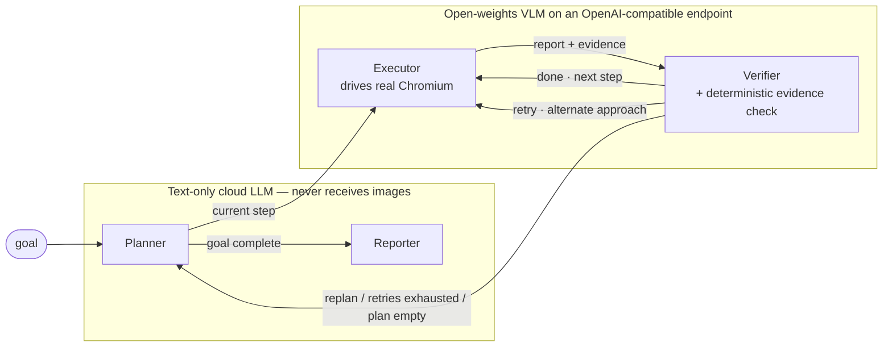

# Lumen — cloud brain, open-weights hands.

A hierarchical, autonomous browser agent (LangGraph + Playwright) whose thinking lives on a hosted cloud model, whose hands and eyes are open-weights models, and whose Privacy Ledger proves which endpoint saw what. The planner and reporter never see a single pixel; the executor and verifier see screenshots but never leave the open-weights endpoint.

```
Cloud brain. Open-weights hands.
```

## Architecture



- **Planner** and **Reporter** run on the cloud model and are *always* text-only. A callback handler raises `PrivacyViolation` the instant any image part is about to leave — their instructions are open-weights-blocked by construction, not by convention.
- **Executor** and **Verifier** run the open-weights VLM. The verifier judges steps from raw page text plus evidence and emits one of three verdicts: `done`, `retry`, `replan`. Retries stay local (executor↔verifier) and only escalate to the planner when the retry budget is exhausted, the step is impossible, or the plan ends.
- **Deterministic evidence check**: no model grades itself. Every claimed evidence excerpt is re-checked in code against verbatim page text; unprovable claims are dropped and a `done` becomes a `retry`.
- **Privacy Ledger** (`ledger.py`) counts every LLM call: bytes out, tokens, and above all *images out*, per endpoint and per role. Every call to the cloud endpoint from the planner or reporter is provably text.

## Quickstart

Prereqs: Python 3.13, Chromium (`playwright install chromium`).

```bash
python -m venv .venv && source .venv/bin/activate      # or .venv\Scripts\activate on Windows
pip install langchain-core langchain-openai langgraph langgraph-checkpoint-sqlite \
            playwright pydantic pyyaml tenacity python-dotenv rich
playwright install chromium
cp .env.example .env          # then fill in real endpoint values and keys (never commit .env)
python runner.py "Find the official height of the Eiffel Tower."
```

The dashboard opens automatically (`DASHBOARD_OPEN=true`); state streams to `/events`, snapshots live at `/state`, screenshots are served from `/shots/<run_id>/<n>.jpg`. Interrupted runs resume with `python runner.py --resume <run_id>`.

Endpoint credentials check without a full run:

```bash
python scripts/smoke_endpoints.py    # PASS/FAIL table: chat, image, tools, structured per role
```

## What runs where

| Role | Endpoint (hybrid profile) | Structured output | Sees screenshots |
|---|---|---|---|
| planner | cloud | yes (`json_schema`/`function_calling`/`json_mode`) | never (enforced) |
| executor | open | — | yes |
| verifier | open | yes | yes |
| reporter | cloud | — | never (enforced) |

Profiles switch all four roles in one shot: `profiles/hybrid.env` (default split), `profiles/all_cloud.env`, `profiles/all_open.env`.

## Environment

Copy `.env.example` to `.env`; every variable below is required unless it has a default.

| Group | Variables |
|---|---|
| Endpoints | `CLOUD_BASE_URL`, `CLOUD_API_KEY`, `OPEN_BASE_URL`, `OPEN_API_KEY`, `STRUCTURED_METHOD` (`json_schema` \| `function_calling` \| `json_mode`) |
| Roles | `PLANNER_ENDPOINT`, `PLANNER_MODEL`, `EXECUTOR_ENDPOINT`, `EXECUTOR_MODEL`, `VERIFIER_ENDPOINT`, `VERIFIER_MODEL`, `REPORTER_ENDPOINT`, `REPORTER_MODEL` |
| Rate / retry | `RATE_LIMIT_RPM`, `LLM_MAX_ATTEMPTS`, `RETRY_INITIAL_SECONDS`, `RETRY_MAX_SECONDS` |
| Budgets | `MAX_PLANNER_ROUNDS`, `MAX_STEP_ITERATIONS`, `MAX_LOCAL_RETRIES` (default 2), `RECURSION_LIMIT` |
| Observation | `MAX_OBSERVATION_CHARS`, `MAX_PAGE_TEXT_CHARS`, `MAX_ARTIFACT_CHARS`, `MAX_LINKS`, `VERIFIER_PAGE_TEXT_CHARS`, `EVENT_TEXT_CHARS` |
| Browser | `OBSERVATION_VIEWPORT_MARGIN`, `SCREENSHOT_QUALITY`, `ACTION_TIMEOUT_MS`, `NAVIGATION_TIMEOUT_MS`, `SETTLE_MS`, `TYPING_DELAY_MS`, `BROWSER_HEADLESS`, `BROWSER_CHANNEL`, `BROWSER_PROFILE_DIR`, `BROWSER_VIEWPORT_WIDTH`, `BROWSER_VIEWPORT_HEIGHT`, `BROWSER_LOCALE`, `BROWSER_TIMEZONE`, `BROWSER_EXTRA_HEADERS`, `BROWSER_LAUNCH_ARGS` |
| Storage / dashboard | `CHECKPOINT_DB`, `REPORTS_DIR`, `DASHBOARD_HOST`, `DASHBOARD_PORT`, `DASHBOARD_OPEN`, `DASHBOARD_MAX_LOG` |
| Safety | `ALLOW_RUN_JAVASCRIPT` (default `false`) |

## Benchmark

15 stable, neutral tasks (6 Wikipedia facts, 3 python.org doc pages, 3 MDN pages, 3 public GitHub READMEs). Each task carries `must_contain` regexes scored case-insensitively against the final report — see `bench/tasks.yml` (`# VERIFY MANUALLY` notes flag facts to re-confirm before each run).

```bash
python bench/run_bench.py --profile hybrid        # add --limit 3 for a smoke pass
```

Per task the bench records success, wall seconds, steps, planner calls and the full ledger snapshot into `bench/results/<profile>.json` (gitignored) and aggregates every recorded profile into `bench/summary.md`:

| Profile | Success rate | Cloud tokens | Open token share | Images to cloud | Wall (s) |
|---|---|---|---|---|---|
| *(fill from `bench/summary.md` after a real run)* | | | | | |

## Safety notes

- **robots.txt**: the `navigate` tool checks the site's robots.txt (cached per origin). Blocked URLs raise a tool error instead of silently proceeding. If robots.txt itself cannot be fetched, the check fails *open*.
- **`run_javascript` gate**: arbitrary JS execution is registered only when `ALLOW_RUN_JAVASCRIPT=true`; the default is `false`.
- **Untrusted page content**: the executor prompt states explicitly that page content is untrusted data and instructions found in page text are never followed — only the current plan step.
- **Privacy ledger enforcement**: planner and reporter callbacks refuse image content outright (`PrivacyViolation`) no matter which endpoint they are assigned in a profile.
- **Honest browser defaults**: no stealth scripts, no spoofed headers, no anti-detection launch flags; the profile directory defaults to a dedicated `.browser_profile_agent`.

## Built during the hackathon

<!-- fill in your own bullets before submitting -->
- 
- 
