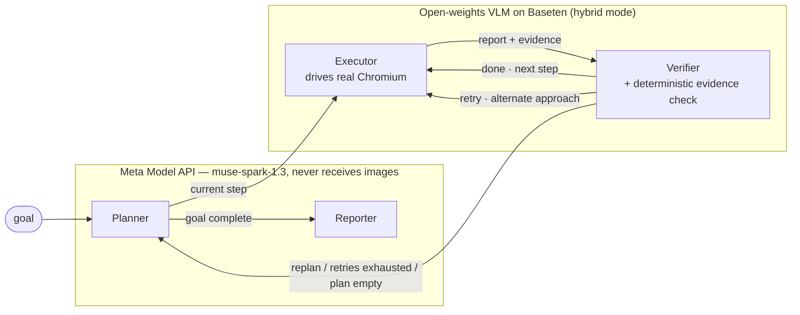
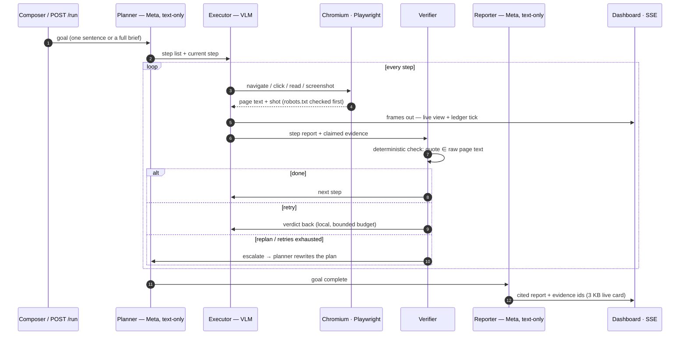

# Nexus — an agentic browser that shows its receipts

> Cloud brain, open-weights hands. An autonomous, stateful multi-agent research browser on LangGraph + Playwright, with a privacy ledger that meters every token, every screenshot, every cent — in one repo, with one secret.

[](https://youtu.be/tXm6MvTuUqs)


[](LICENSE)


A hierarchical, autonomous browser agent (LangGraph + Playwright) that runs with ONE secret: `MODEL_API_KEY` for the Meta Model API. In **cloud-only** mode every role runs on Meta's `muse-spark-1.3`; with the optional `BASETEN_API_KEY` it becomes **hybrid**: planner and reporter stay text-only on Meta, while executor and verifier see screenshots through the open-weights `meta-models/muse-spark-open-1026` on Baseten. The Privacy Ledger proves which endpoint saw what — and now what it cost.

```
Cloud brain. Open-weights hands.
```

## Architecture



- **Planner** and **Reporter** run on the Meta Model API and are *always* text-only. A callback handler raises `PrivacyViolation` the instant any image part is about to leave — their instructions are screenshot-blocked by construction, not by convention.
- **Executor** and **Verifier** see screenshots. In hybrid mode they run the open-weights model on Baseten so page pixels never leave to Meta; in cloud-only mode they run on the Meta Model API. The verifier judges steps from raw page text plus evidence and emits one of three verdicts: `done`, `retry`, `replan`. Retries stay local (executor↔verifier) and only escalate to the planner when the retry budget is exhausted, the step is impossible, or the plan ends.
- **Deterministic evidence check**: no model grades itself. Every claimed evidence excerpt is re-checked in code against verbatim page text (NFKC + typography folding: curly quotes, dashes, NBSP and zero-width characters are normalized before matching); unprovable claims are dropped and a `done` becomes a `retry`.
- **Privacy Ledger** (`ledger.py`) counts every LLM call: bytes out, tokens (including cached tokens), images out per endpoint and role — plus the billed `cost_usd` for the Meta endpoint (the open-weights endpoint runs on Baseten credits, so it never adds billed cost).

## Run workflow



## Quickstart

Prereqs: Playwright-E2E:

```bash
python scripts/ui_check.py     # Playwright 1920x1080 over the built UI: composer -> live plan/evidence/report + zero console errors
```
Python 3.13+, Node 20+ (for the UI build), Chromium (`python -m playwright install chromium`).

```bash
python -m venv .venv && source .venv/bin/activate      # or .venv\Scripts\activate on Windows
pip install -r requirements.txt
playwright install chromium
cp .env.example .env          # put your ONE key in .env: MODEL_API_KEY=... (never commit .env)
python scripts/smoke_endpoints.py    # prints the resolved mode, then a PASS/FAIL table: chat, image (where allowed), tools, structured per role
python scripts/build_ui.py           # installs the web UI and builds it into web/out
python runner.py                     # one process: agent + API + UI on the printed URL
```

`runner.py` preflights the key against `GET https://api.meta.ai/v1/models` at startup: a 401 exits with guidance, network trouble only warns. The active mode is printed in a startup banner, e.g. `Mode: HYBRID | planner+reporter -> Meta Spark | executor+verifier -> Baseten`.

Open the printed URL (default <http://127.0.0.1:8765/>). Give the agent a goal in either of two ways:

- **Composer UI** — type it in, press Ctrl/⌘+Enter to start, Cancel to stop;
- **CLI** — `python runner.py "Find the official height of the Eiffel Tower."`: the run finishes, then the process stays in serve mode. Add `--once` to exit after the run (what benchmark harnesses want).

State flows to the UI over SSE at `/events`; snapshots live at `/state`, screenshots at `/shots/<run_id>/<n>.jpg`. Interrupted runs continue with `python runner.py --resume <run_id>`. The recognized API:

| Route | Purpose |
|---|---|
| `POST /run` `{"goal": ...}` | queue a goal → `202 {"run_id": ...}`; `409 {"error":"busy"}` while a run is active; `400` on bad input |
| `POST /cancel` | cancel the active run (`409` when idle) |
| `GET /health` | `{"ok": true, "busy": <bool>}` |
| `GET /state`, `GET /events` | full state snapshot / SSE stream of the same state |

A failing run publishes an `error` event and the process keeps serving — one bad goal never kills the server. If `web/out` is missing, `/` falls back to the legacy inline dashboard with a build hint.

Endpoint and contract checks without a full run:

```bash
python scripts/smoke_endpoints.py    # resolved mode + PASS/FAIL: chat, image (where allowed), tools, structured per role
python scripts/contract_check.py     # backend ⇄ TypeScript shapes + server routes, no browser/LLM
python scripts/test_evidence.py      # 8 verbatim evidence-matching cases, no browser/LLM
```

## Modes

`NEXUS_MODE` in `.env` maps the four roles to endpoints (default `auto` = hybrid when `BASETEN_API_KEY` is set, else cloud-only):

| Mode | Planner | Executor | Verifier | Reporter | Needs |
|---|---|---|---|---|---|
| `CLOUD-ONLY` | Meta muse-spark-1.3 (text-only) | Meta muse-spark-1.3 | Meta muse-spark-1.3 | Meta muse-spark-1.3 (text-only) | `MODEL_API_KEY` |
| `HYBRID` | Meta muse-spark-1.3 (text-only) | Baseten `meta-models/muse-spark-open-1026` | Baseten `meta-models/muse-spark-open-1026` | Meta muse-spark-1.3 (text-only) | `MODEL_API_KEY` + `BASETEN_API_KEY` |

Screenshots are processed by the Meta Model API in cloud-only mode and by the open-weights Baseten model in hybrid mode. Reasoning effort (`minimal|low|medium|high|xhigh|max`; `"none"` is rejected by the API) is only sent to the Meta endpoint. Never use `*-contributor` models (see the warning below). Profiles switch the whole stack in one shot: `profiles/hybrid.env`, `profiles/all_cloud.env`.

> **Warning — Contributor mode**: with Contributor mode, Meta may train on your prompts and screenshots. `*-contributor` model ids are therefore rejected at startup unless `ALLOW_CONTRIBUTOR=true` is set — keep it unset.

### Dev mode (two terminals)

Rebuild-free UI work against a live backend:

```bash
# terminal 1: backend (serves the API on 8765)
python runner.py

# terminal 2: Next.js dev server, pointed at the backend
cd web
# Windows PowerShell:  $env:NEXT_PUBLIC_NEXUS_URL="http://127.0.0.1:8765"
NEXT_PUBLIC_NEXUS_URL=http://127.0.0.1:8765 npm run dev
```

Then open <http://localhost:3000>. Without `NEXT_PUBLIC_NEXUS_URL` the UI assumes same origin (the single-process case); demo replay still works with no backend at `/?demo=1`.

## Environment

Copy `.env.example` to `.env`; only `MODEL_API_KEY` is required — everything else has a code default (`schemas.py` is the single source of truth for the full list).

| Group | Variables |
|---|---|
| Secrets | `MODEL_API_KEY` (required), `BASETEN_API_KEY` (optional — enables HYBRID) |
| Mode | `NEXUS_MODE` (`auto` \| `hybrid` \| `cloud`) |
| Per role (planner/executor/verifier/reporter) | `{ROLE}_MODEL`, `{ROLE}_REASONING_EFFORT` (`minimal`\|`low`\|`medium`\|`high`\|`xhigh`\|`max`), `{ROLE}_MAX_TOKENS` — all optional overrides |
| OpenAI SDK | `STRUCTURED_METHOD` (`json_schema` default \| `function_calling`), `RATE_LIMIT_RPM` (default 300) |
| Rate / retry | `LLM_MAX_ATTEMPTS`, `RETRY_INITIAL_SECONDS`, `RETRY_MAX_SECONDS` |
| Budgets | `MAX_PLANNER_ROUNDS`, `MAX_STEP_ITERATIONS`, `MAX_LOCAL_RETRIES`, `RECURSION_LIMIT` |
| Observation | `MAX_OBSERVATION_CHARS`, `MAX_PAGE_TEXT_CHARS`, `MAX_ARTIFACT_CHARS`, `MAX_LINKS`, `VERIFIER_PAGE_TEXT_CHARS`, `EVENT_TEXT_CHARS` |
| Browser | `OBSERVATION_VIEWPORT_MARGIN`, `SCREENSHOT_QUALITY`, `ACTION_TIMEOUT_MS`, `NAVIGATION_TIMEOUT_MS`, `SETTLE_MS`, `TYPING_DELAY_MS`, `BROWSER_HEADLESS`, `BROWSER_CHANNEL`, `BROWSER_PROFILE_DIR`, `BROWSER_VIEWPORT_WIDTH`, `BROWSER_VIEWPORT_HEIGHT`, `BROWSER_LOCALE`, `BROWSER_TIMEZONE`, `BROWSER_EXTRA_HEADERS`, `BROWSER_LAUNCH_ARGS` |
| Storage / dashboard | `CHECKPOINT_DB`, `REPORTS_DIR`, `DASHBOARD_HOST`, `DASHBOARD_PORT`, `DASHBOARD_OPEN`, `DASHBOARD_MAX_LOG` |
| Safety | `ALLOW_RUN_JAVASCRIPT` (default `false`), `ALLOW_CONTRIBUTOR` (default unset) |

## Benchmark

15 stable, neutral tasks (6 Wikipedia facts, 3 python.org doc pages, 3 MDN pages, 3 public GitHub READMEs). Each task carries `must_contain` regexes scored case-insensitively against the final report — see `bench/tasks.yml` (`# VERIFY MANUALLY` notes flag facts to re-confirm before each run).

```bash
python bench/run_bench.py --profile hybrid        # add --limit 3 for a smoke pass
```

Per task the bench records success, wall seconds, steps, planner calls and the full ledger snapshot into `bench/results/<profile>.json` (gitignored) and aggregates every recorded profile into `bench/summary.md`:

| Profile | Success rate | Cloud tokens | Open token share | Images to cloud | Wall (s) |
|---|---|---|---|---|---|
| *(fill from `bench/summary.md` after a real run)* | | | | | |

## The three-minute demo

**Watch the reel:** <https://youtu.be/tXm6MvTuUqs> — submitted via the Cerebral Valley platform (primary judging artifact), built with the repo's own recording kit — every dashboard frame is one genuine run, no staging, no invented numbers:

| artifact | what it is |
|---|---|
| `demo/out/nexus_demo.mp4` | 101.6 s · 1920×1080 H.264 — intro card → real composer typing → Start → planner split → source navigation (SIA → commerce.gov → NIST → OECD) → 4 verbatim-verified evidence quotes → a live bot-check pivot → Privacy Ledger at the cut |
| `demo/out/nexus_demo.srt` | caption sidecar (10 cues, real timestamps) — captions are **not** burned into the frame |
| `demo/out/proof_cut.mp4` / `demo/out/proof_contact_sheet.png` | 35 s teaser + 6-frame verification sheet |
| `demo/build_demo_from_proof.py` | rebuilds the video from run bytes in ~1 min, zero LLM spend (`python demo/record_demo.py` records a fresh one) |

**Disclosed honestly:** the shown run hit the recorder's watchdog mid-research (still executing at T+4:58 with the Evidence panel at 4 verified quotes). It proves the engine at depth; a finished-run cut needs a goal that completes in ≤ ~165 s. Run receipts (visible on screen in the video, all from the Privacy Ledger):

| meter | value at the cut |
|---|---|
| billed (Meta endpoint) | **$0.22** |
| analyzer calls | 24 |
| tokens | 199k |
| bytes out (frames + text) | 3.2 MB |
| screenshots sent to cloud | 23 → 24 |
| sites visited | 10 |
| evidence (verbatim-verified) | 4 quotes |
| escalations (verifier → planner re-plan) | 1 |
| billed tokens on open weights | 0.0 % (cloud-only mode; hybrid sends page pixels to Baseten instead) |

## Roadmap

- **Search that bots can't scam:** a LangGraph-native `web_search` tool node (moderated SERP/SearXNG provider) so the planner starts from structured results instead of steering Chromium into bot-walled search engines — the run above shows exactly why: DuckDuckGo threw an "are you human" interstitial, the agent pivoted to NIST and OECD instead of crashing.
- **Muse Image inside reports:** render charts/diagrams for quantitative findings (the goal brief already asks for "quantitative comparisons") via `Muse Image` through the same one-secret settings surface, images metered separately in the ledger.
- **Muse Voice Transcribe:** dictate the goal, get an audio briefing of the finished report; also feeds the demo recorder's `--voiceover path.wav` mux.
- **Muse Wonder + SAM 3.1:** prompt-driven storyboard for complex multi-entity pages and click-level visual grounding on screenshots for the executor's pointer decisions.
- **HitL checkpoints:** pause-and-ask entry points for ambiguous research paths before the swarm wanders (the application pitch) — plumbing already splits planner/user roles.
- **Swarm lanes:** run independent plan branches as parallel executor/verifier pairs on disjoint tabs, merged by the planner — the LangGraph state graph is already role-typed for it.

## Safety notes

- **robots.txt**: the `navigate` tool checks the site's robots.txt (cached per origin). Blocked URLs raise a tool error instead of silently proceeding. If robots.txt itself cannot be fetched, the check fails *open*.
- **`run_javascript` gate**: arbitrary JS execution is registered only when `ALLOW_RUN_JAVASCRIPT=true`; the default is `false`.
- **Untrusted page content**: the executor prompt states explicitly that page content is untrusted data and instructions found in page text are never followed — only the current plan step.
- **Privacy ledger enforcement**: planner and reporter callbacks refuse image content outright (`PrivacyViolation`); in both modes their endpoint only ever receives text, and in hybrid mode screenshots go to the open-weights Baseten endpoint instead of Meta.
- **Contributor-mode guard**: any `*-contributor` model id fails startup validation unless `ALLOW_CONTRIBUTOR=true` (Contributor mode lets Meta train on prompts and screenshots).
- **Honest browser defaults**: no stealth scripts, no spoofed headers, no anti-detection launch flags; the profile directory defaults to a dedicated `.browser_profile_agent`.

## Built during the hackathon

All commits from `9e6a7eb` (T0) onward landed during this hackathon on top of the baseline (`07f6d47`):

- T0–T5: honest-browser hygiene (robots.txt + `run_javascript` gates, untrusted-content rule), OpenAI-compatible provider swap with the Privacy Ledger core, verdict routing with local retries, deterministic evidence checks against verbatim page text, hub ledger wiring, per-run screenshots with stable evidence ids cited end-to-end
- T6–T8 / I1–I8: validated server API, long-lived serve mode, run control (`POST /run`, `/cancel`, `/health`), error/escalation/evidence-check handling in the hub, single-process deployment (static UI served by `runner.py`), MissionComposer, contract guard, quickstart docs, encoding-hardened run logging
- K1–K7: one-secret config (`MODEL_API_KEY` only), mode auto-detect (cloud-only vs hybrid), preflight + smoke probes, evidence matching without false rejections (NFKC + typography folding), `muse-spark-1.3` cost ledger surfaced in the UI, deduped sites-visited tracking, contract + docs sync
- FE1–FE3: screenshot harness, mode-aware state/demo layer, fixed-grid mission-control layout (Live/Report/Graph stages, keyboard tabs)
- X1–X9 (the QA pass behind this submission): contract check, real-API smoke (14 checks), 11-gate run checker with cost/timeout cancels, Playwright E2E over the built UI (9 gates, zero console errors), fresh-clone test, secret-hygiene scan, committed `web/out` so judges need no Node
